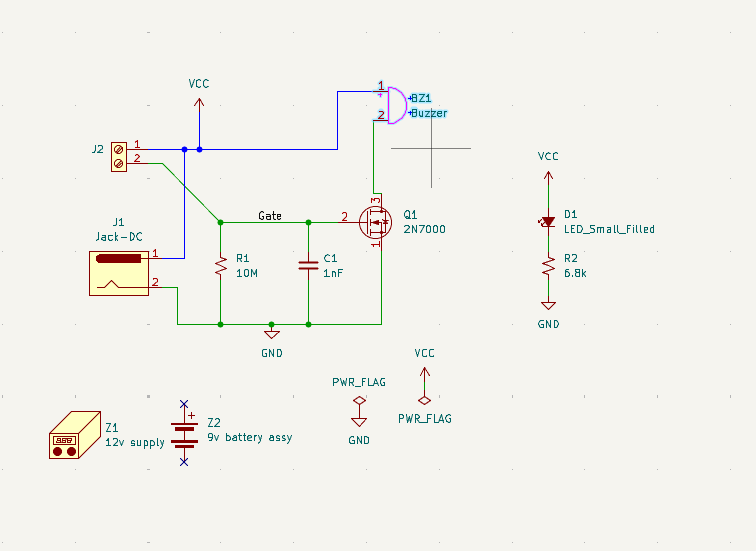
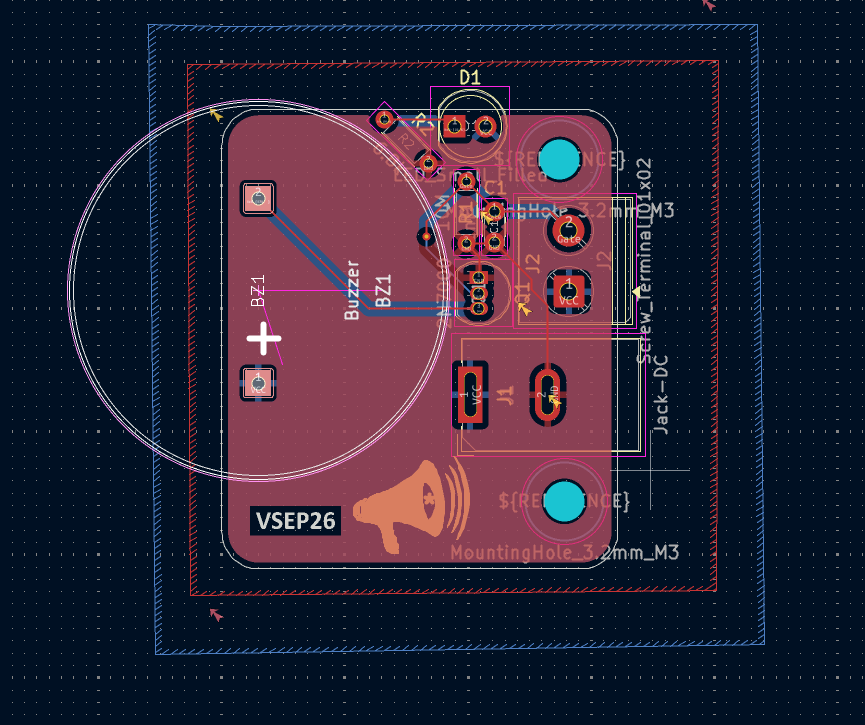
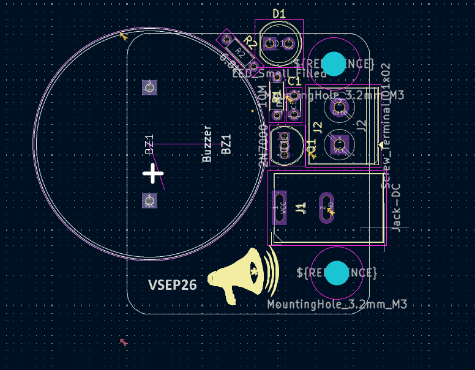

# Water Level Alarm PCB

A PCB design for a **Water Level Alarm System** developed using **KiCad**.

The project contains the schematic, PCB layout, 3D views, and Gerber manufacturing files.

## 📁 Project Structure


|DRC Clean_image.png
│   README.md
│   symbol_field_table.png
│   
├───gerber_files
│       water_alaram-B_Cu.gbr
│       water_alaram-B_Cu.zip
│       water_alaram-B_Mask.gbr
│       water_alaram-B_Silkscreen.gbr
│       water_alaram-Edge_Cuts.gbr
│       water_alaram-F_Cu.gbr
│       water_alaram-F_Mask.gbr
│       water_alaram-F_Silkscreen.gbr
│       water_alaram-NPTH.drl
│       water_alaram-PTH.drl
│       
├───pcb_views
│       3d_view1.png
│       3d_view2.png
│       3d_view3.png
│       All_layers.png
│       Back_layer.png
│       Front_layer.png
│       full_layer.png
│       
└───schematic
        schematic_view.png

```

## 🔧 Tools Used

* **KiCad** – Schematic and PCB design
* **Gerber Viewer** – Gerber file verification

## 📐 Design Files

### Schematic

The `schematic/` directory contains the circuit schematic views.



### PCB Layout

The `views_3d_pcb/` directory contains different PCB layout views.



### 3D PCB View

The 3D renders show the physical appearance of the designed PCB.



## 🏭 Manufacturing Files

The `gerber_files/` directory contains the files required for PCB fabrication.

### Included Files

* Copper layers
* Solder mask layers
* Silkscreen layers
* Board edge cuts
* PTH drill file
* NPTH drill file

These files can be uploaded to a PCB manufacturer for fabrication.

## 📊 Project Status

* [x] Schematic completed
* [x] PCB layout completed
* [x] 3D PCB view generated
* [x] Gerber files generated
* [x] Drill files generated
* [ ] PCB fabrication
* [ ] Hardware testing

## ⚠️ Note

Files containing `- Copy` in their names are duplicate files and should be checked before manufacturing.

Verify the Gerber files using a Gerber viewer before sending them for fabrication.

## 👤 Author

**Nithesh**

## 📄 License

This project is provided for educational and project development purposes.
